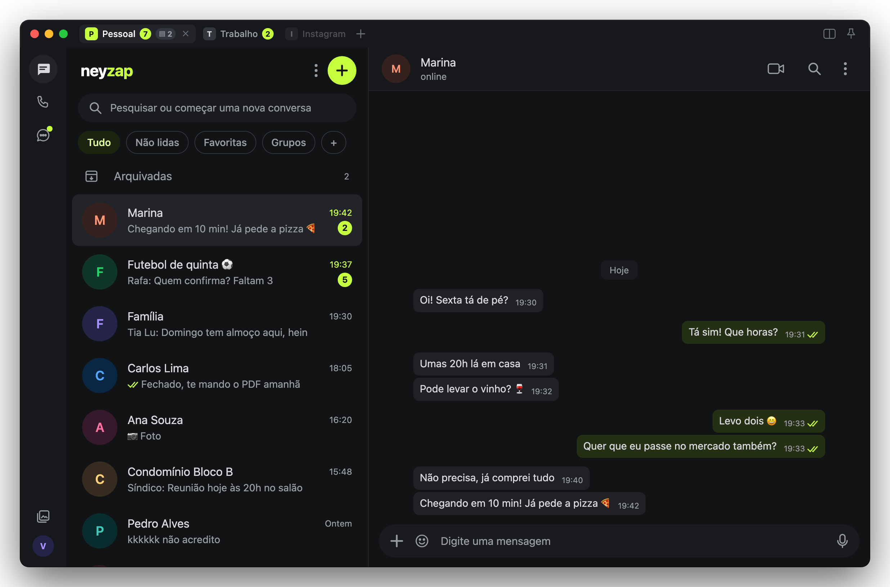
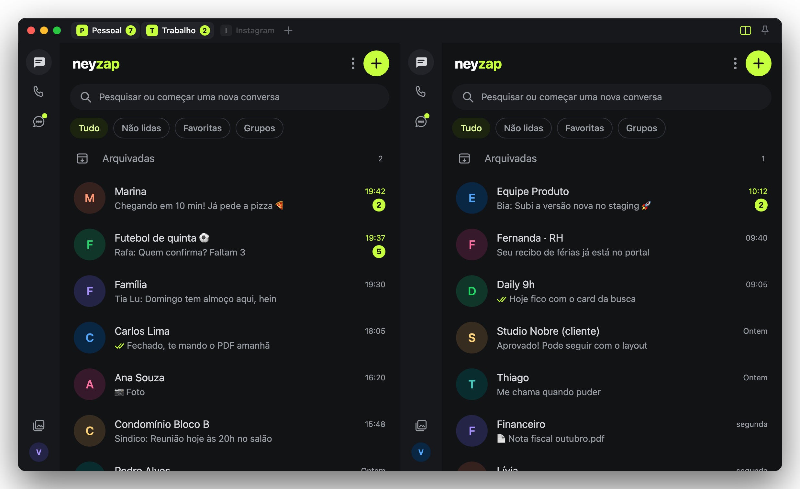
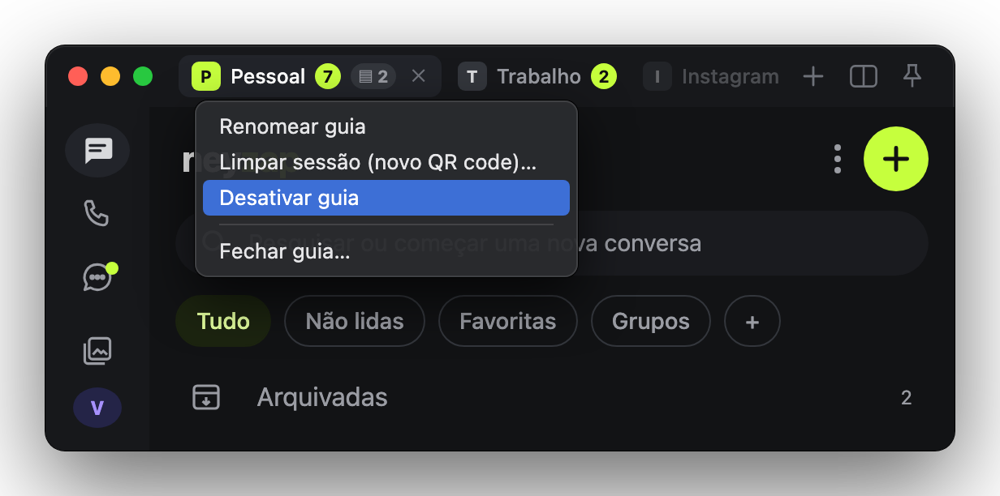
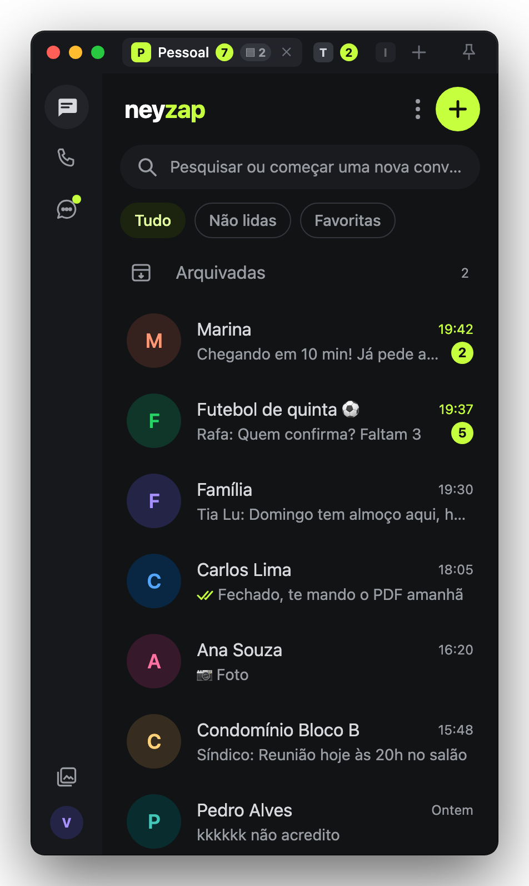
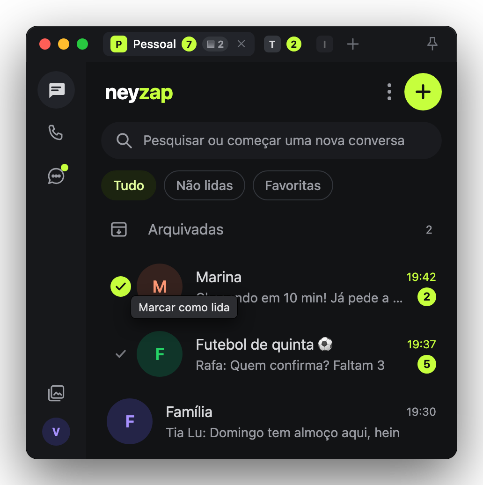

<p align="center"></p>

<h1 align="center">NeyZap</h1>

<p align="center">WhatsApp com uma UI decente no Mac: várias contas na mesma janela, o Instagram junto e o visual Grafite dos apps do NeyHub.</p>

<p align="center"><a href="https://github.com/yagoramires/neyzap/releases/latest"><b>Baixar a última versão</b></a> · <a href="https://github.com/yagoramires/neyzap/issues/new">Reportar problema</a> · <a href="CHANGELOG.md">Novidades</a></p>



<p align="center"><sub>Todos os prints usam contatos e mensagens de exemplo.</sub></p>

O NeyZap é uma alternativa ao app nativo da Meta. Por baixo é o **WhatsApp Web oficial** numa janela de verdade do Mac: nada de cliente pirata nem automação, então o risco para o seu número é o mesmo de usar o site no Safari. Em volta dele vêm o que faltava:

- **Várias contas** em guias, cada uma com o seu QR code, recebendo e notificando mesmo fora da tela.
- **Instagram numa guia**, ao lado dos seus WhatsApps.
- **Visual Grafite**: grafite com destaque verde-limão, sem papel de parede, sem Meta AI, Status, Comunidades nem propaganda.
- **Janela de qualquer tamanho**, de tela cheia até uma coluna estreita no canto da tela.
- **Marcar como lida sem abrir**, notificações com a foto do contato e atalhos de Mac.

## Instalar

1. Baixe o `.dmg` da [última versão](https://github.com/yagoramires/neyzap/releases/latest) (ou o `.zip`), abra e arraste o **NeyZap** para **Aplicativos**.
2. Na primeira vez o macOS bloqueia o app, porque ele não é assinado por uma conta de desenvolvedor da Apple. Clique com o botão direito no app → **Abrir**, ou abra **Ajustes do Sistema → Privacidade e Segurança**, role até o aviso sobre o NeyZap e clique em **Abrir Mesmo Assim**. Se o macOS disser que o app está danificado, rode no Terminal:
   ```sh
   xattr -dr com.apple.quarantine /Applications/NeyZap.app
   ```
3. Leia o QR code com o celular (**Aparelhos conectados → Conectar aparelho**).

Requer macOS 14 ou mais novo. Depois disso o app se atualiza sozinho (veja **Atualizações**).

## Várias contas



- **Guias como num navegador**: uma por número. A guia aberta tem a inicial em limão; o selo limão conta as não lidas e o cinza, as arquivadas com mensagem nova. **+** (⌘T) conecta outro número pelo QR, duplo clique renomeia e **×** fecha.
- **Contas independentes**: a guia fora da tela continua recebendo e notificando, sem marcar nada como lido.
- **Lado a lado** (⌘\\): todas as contas visíveis ao mesmo tempo, como no print acima.



- **Clique direito na guia**: renomear, limpar a sessão (novo QR code), desativar ou fechar.
- **Desativar guias**: a guia para de carregar (zero RAM e CPU), mas continua logada; *Ativar guia* volta de onde estava. Perfeito para o WhatsApp do trabalho no fim de semana. Uma guia desativada há 7 dias conecta escondida por 15 min, para o aparelho não ser desconectado por inatividade.

<br clear="right">

## Janela de qualquer tamanho

<table>
  <tr>
    <td width="50%"></td>
    <td width="50%"></td>
  </tr>
  <tr>
    <td align="center"><sub>Estreita: uma coluna por vez, guias de trás só com a inicial</sub></td>
    <td align="center"><sub>Conversa aberta, com o botão de voltar (⌘[)</sub></td>
  </tr>
</table>

- Abaixo de 760 px vira **uma coluna por vez**, como no celular, com botão de voltar (⌘[).
- Quando os nomes não cabem, as guias de trás ficam só com a inicial e os selos; nenhuma guia some.
- Conversa estreita (inclusive com a lista aberta ao lado) usa a largura toda, sem o respiro lateral do WhatsApp.
- Painéis, emojis, fotos, prévias e a tela **Mídia** se ajustam ao tamanho.
- **Sempre na frente** (⌥⌘T) e zoom (⌘+ / ⌘− / ⌘0).

## Um WhatsApp melhor



- **Marcar como lida num clique**: o ✓ à esquerda da foto marca a conversa como lida sem abrir (inclusive nas Arquivadas).
- **Clique direito como no navegador**: o menu do WhatsApp (Reagir, Responder, Copiar…) em qualquer parte da mensagem, inclusive em cima do texto.
- **Mais limpo**: sem Meta AI, Status, Comunidades e sugestões de canais, sem propaganda do app oficial, sem papel de parede, sem barras de rolagem.
- **Tema próprio**: `NeyZap → Editar tema` (⌘,) abre um CSS que aplica ao salvar.

<br clear="right">

### Notificações com a foto do contato


Com o nome da guia, abrem a conversa no clique e não somem com o mouse em cima. Prefere as do sistema? `NeyZap → Usar notificações do sistema` (aí o macOS pede a permissão de notificações).

## Instagram

- **Instagram numa guia**: no **+** escolha *Instagram* (ou ⇧⌘T). É o site oficial, com login próprio, ao lado das guias do WhatsApp. ⌘[ volta uma página.
- **Sem vídeo tocando escondido**: pausa ao trocar de guia, fechar a janela ou esconder o app.

## Feito para o Mac

- **Integração**: contador no Dock, atalho global **⌃⌥Z**, abrir ao iniciar sessão, downloads em `~/Downloads`. Fechar a janela (⌘W) não desliga: as mensagens continuam chegando.
- **RAM sob controle**: guia escondida que passa de 1,5× o tamanho de recém-aberta (mínimo 1 GB) é recarregada sozinha, e uma página do WhatsApp que trava é reiniciada. Guia em chamada não é tocada.
- **Sessões que ficam**: feche e abra o app à vontade, as contas continuam logadas.

## Atalhos

| Atalho | Ação |
| --- | --- |
| ⌃⌥Z | Mostrar/esconder o NeyZap de qualquer lugar |
| ⌘1 … ⌘9 | Trocar de guia |
| ⌘T | Nova guia de WhatsApp (conectar outro número) |
| ⇧⌘T | Nova guia do Instagram |
| ⌘\\ | Guias lado a lado |
| ⌘[ | Voltar (lista de conversas / página anterior no Instagram) |
| ⌥⌘T | Sempre na frente |
| ⌘+ / ⌘− / ⌘0 | Zoom |
| ⌘R | Recarregar a guia |
| ⌘, | Editar tema (CSS) |
| ⌘W / ⌘Q | Esconder janela / encerrar |

## Limitações

- Chamadas de voz e vídeo seguem o que o WhatsApp Web oferece.
- O Instagram não notifica nem entra no contador do Dock.
- As notificações com foto são desenhadas pelo próprio app (o macOS só permite trocar o ícone pela foto em apps de desenvolvedor pago), então não ficam na Central de Notificações nem respeitam o modo Foco.

## Permissões

- **Câmera**: "O NeyZap usa a câmera para tirar fotos dentro das conversas."
- **Microfone**: "O NeyZap usa o microfone para gravar mensagens de voz."
- Câmera e microfone valem só para o WhatsApp Web.
- Notificações: só se você escolher as notificações do sistema.

## Privacidade e segurança

- O código injetado no WhatsApp Web **só mexe na aparência** e lê a tela para notificações e contadores. Ele nunca envia mensagens, nunca automatiza ações e nunca acessa os módulos internos do WhatsApp. As únicas ações automáticas são clicar em **Ativar** no aviso "notificações desativadas" e ligar a **Sincronização em segundo plano** nas configurações (com a conta fora da tela), preferências locais deste Mac. O ✓ de marcar como lida só age quando você clica nele, escolhendo "Marcar como lida" no menu da própria conversa.
- As guias do Instagram são o site puro: nada é injetado nelas.
- Tudo fica no seu Mac: sessões em armazenamentos separados por conta, nada é enviado para servidores além do próprio WhatsApp/Instagram.
- A chave que protege as sessões fica num arquivo que só o seu usuário lê (`~/Library/Application Support/NeyZap/webcrypto.key`), e não no Chaveiro: sem conta de desenvolvedor da Apple, o Chaveiro pediria a senha a cada atualização do app. Quem tem acesso ao seu usuário do Mac consegue ler esse arquivo, como acontece com os dados de qualquer navegador.
- O log de depuração (`NeyZap → Logs de depuração`) registra eventos do app, nunca o conteúdo das conversas.
- Arquivos baixados das conversas ganham a marca de "baixado da internet", então o macOS avisa antes de abrir instaladores e apps. Links externos abrem no navegador.
- Para desenvolvimento existe um canal de depuração pelo terminal capaz de rodar código nas guias abertas. Ele vem **desligado** e, mesmo ligado, só aceita comandos com uma senha nova a cada abertura, guardada num arquivo que só o seu usuário lê (veja [docs/DESENVOLVIMENTO.md](docs/DESENVOLVIMENTO.md)).

## Atualizações

O app baixa a versão nova daqui do GitHub, confere a assinatura e se instala; é só escolher reiniciar agora ou depois. A verificação só consulta a lista de versões deste repositório e baixa o zip publicado aqui. O que mudou em cada versão está no [CHANGELOG](CHANGELOG.md).

## Build local

Precisa só das Command Line Tools (`xcode-select --install`), não do Xcode.

```sh
scripts/setup-signing.sh   # uma vez: certificado local "NeyZap Local Signing"
scripts/build.sh           # compila e assina build/NeyZap.app
```

Mais detalhes (instalação em Aplicativos, reinício, canal de depuração, prints do README) em [docs/DESENVOLVIMENTO.md](docs/DESENVOLVIMENTO.md).

## Licença

[MIT](LICENSE)

<sub>Projeto pessoal, sem vínculo com o WhatsApp, o Instagram ou a Meta. WhatsApp, Instagram e seus logotipos são marcas registradas da Meta Platforms, Inc. O ícone do app (`Resources/AppIcon.icns`, `design/`, `docs/icon.png`) é derivado do logotipo do WhatsApp e **não** faz parte da licença MIT do código.</sub>
